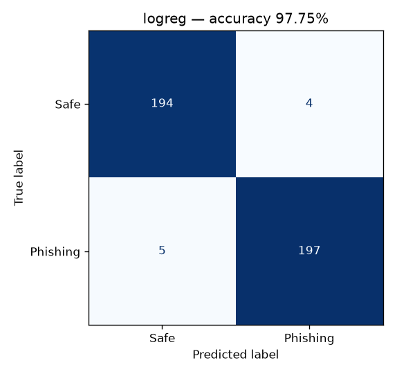

# Phishing Email Detection

A scikit-learn model that classifies emails as **Phishing** or **Safe** using the email text
together with hand-crafted URL and keyword features. It reports accuracy, a classification
report, and a confusion matrix.



## Quick start

```bash
pip install -r requirements.txt
python train.py                  # trains on data/emails.csv, prints accuracy + confusion matrix
python predict.py --explain "Your account is suspended. Verify now at http://192.168.4.20/login.php"
```

Example output from `python train.py`:

```
Accuracy: 0.9775
Confusion matrix (rows = actual, cols = predicted):
                 pred Safe  pred Phishing
actual Safe            194              4
actual Phishing          5            197
```

## How it works

| Step | Details |
|------|---------|
| **Dataset** | `data/emails.csv`: 2,000 labelled emails made by `data/generate_dataset.py`. They include hard cases (legitimate password resets and urgent notices, phishing with no link or with legitimate-looking links) and about 2% label noise, so the dataset is not trivially separable. |
| **Text features** | Word TF-IDF (1–2-grams) and character TF-IDF (3–5-grams), which pick up look-alike spellings such as `p4ypal`. |
| **URL features** | Number of URLs, IP-address hosts, plain `http://`, suspicious TLDs (`.xyz`, `.tk`, …), URL shorteners, `@` in the URL, URL length, hyphens and subdomains in the host, and digits mixed into the host. |
| **Keyword features** | Counts of urgency words, credential requests, reward/prize wording, generic greetings, `!`, the share of uppercase letters, and the email's length. |
| **Model** | A `Pipeline` of a `FeatureUnion` of the three feature groups, followed by `LogisticRegression`. Random forest and complement naive Bayes can be used instead. |
| **Evaluation** | A stratified 80/20 train/test split. Prints accuracy, precision, recall and F1, prints the confusion matrix, and saves it as a PNG in `outputs/`. |

After training, the script lists the strongest phishing indicators it learned. The
hand-crafted features (credential requests, urgency, plain-HTTP links, hyphenated
look-alike domains) have the largest weights.

## Using your own / a real dataset

Any CSV file with a text column and a label column works. Labels such as `Phishing`/`Safe`,
`1`/`0` and `Phishing Email`/`Safe Email` are recognised. For example, with the Kaggle
*Phishing Email Detection* dataset:

```bash
python train.py --data Phishing_Email.csv --text-col "Email Text" --label-col "Email Type"
```

## Commands

```bash
python train.py --compare                       # compare logreg / random_forest / naive_bayes, keep the best
python train.py --classifier random_forest      # choose a specific classifier
python data/generate_dataset.py --n 5000        # regenerate a larger sample dataset
python predict.py --file email.txt              # classify an email stored in a file
python -m pytest -q                             # run tests
```

## Project layout

```
data/generate_dataset.py      sample dataset generator (data/emails.csv)
phishing_detector/features.py URL + keyword feature extraction (sklearn transformer)
phishing_detector/model.py    pipeline definition, load / predict helpers
train.py                      training + evaluation (accuracy, confusion matrix)
predict.py                    CLI for classifying new emails
tests/                        unit tests
```
